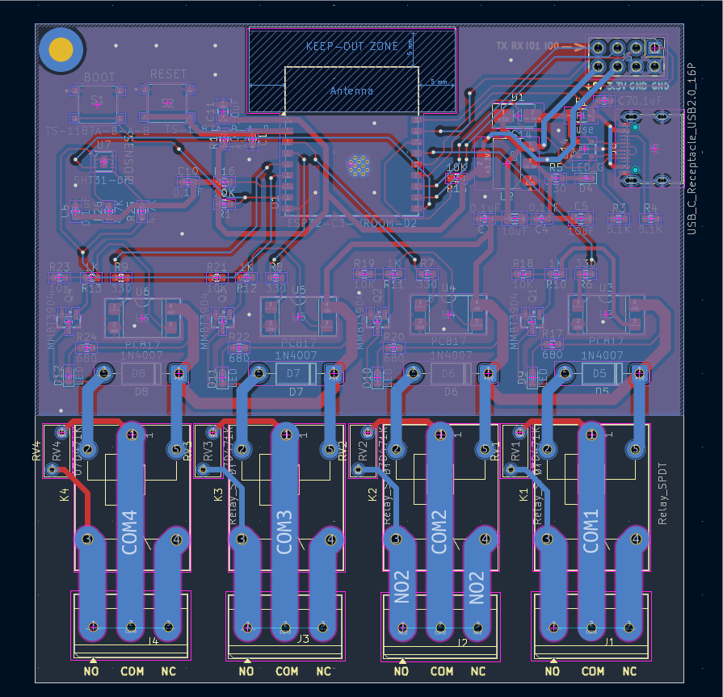
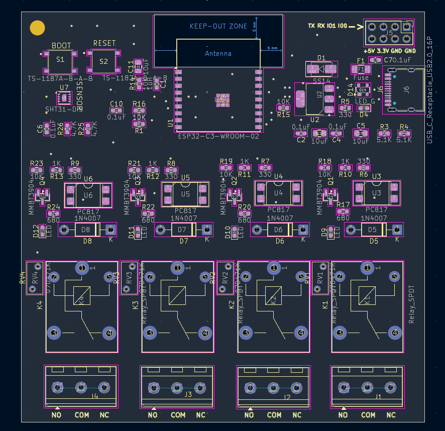
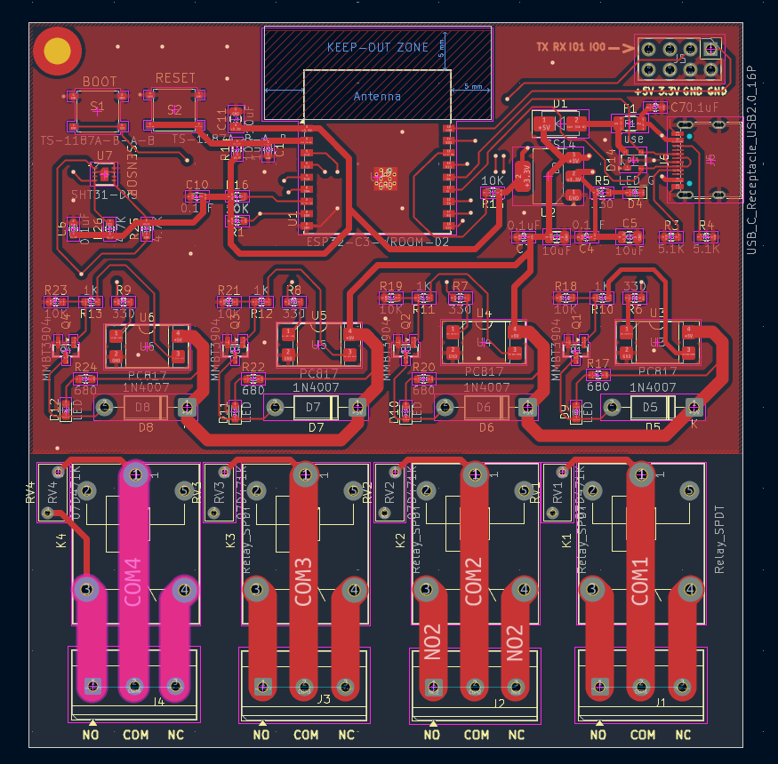
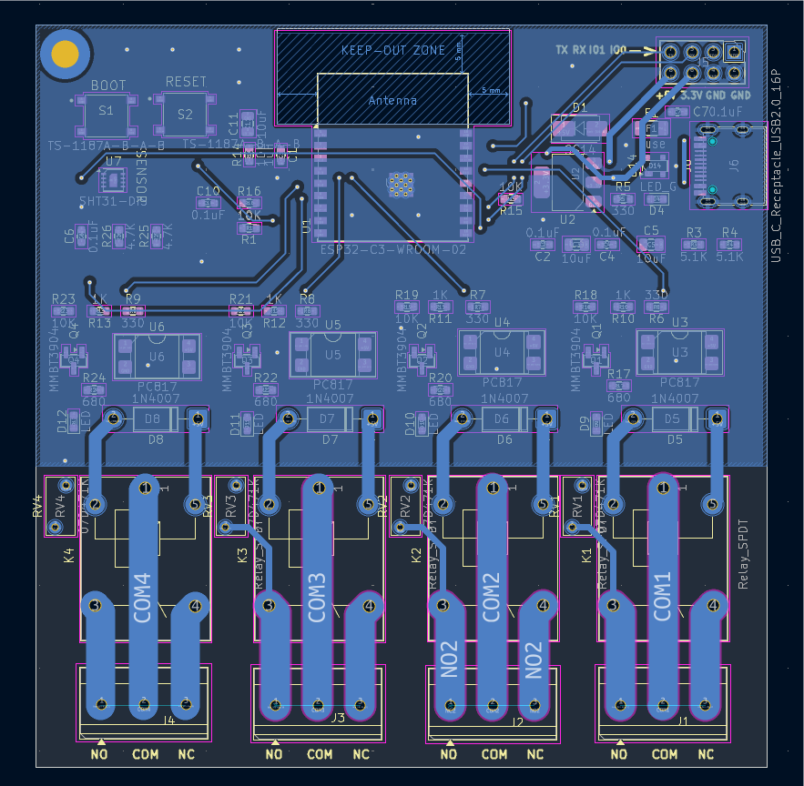
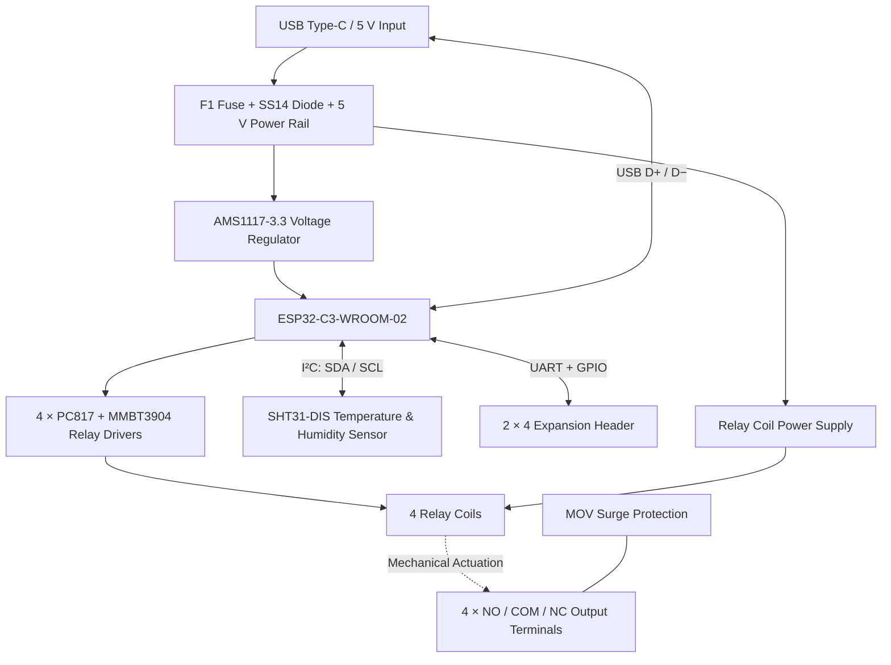

<div align="center">

# ESP32-C3 MINI

### Bo mạch điều khiển IoT Wi-Fi & Bluetooth LE · 4 kênh relay · Cảm biến SHT31

**Bo mạch PCB 2 lớp được thiết kế bằng KiCad, tích hợp ESP32-C3, 4 ngõ ra relay, cảm biến nhiệt độ/độ ẩm SHT31, cổng USB Type-C và đầu mở rộng GPIO/UART.**


**[Giới thiệu](#-giới-thiệu) · [Hình ảnh PCB](#-hình-ảnh-pcb) · [Phần cứng](#-kiến-trúc-phần-cứng) · [Sơ đồ chân](#-bảng-phân-bổ-chân) · [Cấu trúc dự án](#-cấu-trúc-thư-mục) · [Hướng dẫn sử dụng](#-hướng-dẫn-sử-dụng)**

</div>

---

## 📖 Giới thiệu

**ESP32-C3 MINI** là bo mạch điều khiển IoT được thiết kế riêng, phục vụ các ứng dụng điều khiển thiết bị và giám sát môi trường. Trung tâm hệ thống là mô-đun **ESP32-C3-WROOM-02**, kết hợp **4 relay chuyển mạch SPDT** và cảm biến nhiệt độ, độ ẩm **Sensirion SHT31-DIS**.

Thiết kế phù hợp để phát triển các ứng dụng tự động hóa sử dụng Wi-Fi, thu thập dữ liệu cảm biến và điều khiển tải thông qua relay. Repository này tập trung vào **thiết kế phần cứng, PCB và các tệp phục vụ sản xuất**; chưa bao gồm mã nguồn firmware ứng dụng trong bộ dữ liệu đã cung cấp.

### ✨ Tính năng nổi bật

- **ESP32-C3-WROOM-02:** hỗ trợ Wi-Fi 2,4 GHz và Bluetooth Low Energy (BLE).
- **4 kênh relay SPDT:** mỗi kênh sử dụng PC817 và transistor MMBT3904 để điều khiển cuộn relay.
- **Đầu nối NO / COM / NC:** mỗi relay có một terminal 3 chân để đấu nối tải.
- **SHT31-DIS:** cảm biến đo nhiệt độ và độ ẩm, giao tiếp I²C.
- **USB Type-C:** cấp nguồn 5 V và kết nối các đường dữ liệu USB tích hợp trên ESP32-C3.
- **Hai nút BOOT và RESET:** hỗ trợ khởi động, nạp chương trình và kiểm thử.
- **Đầu mở rộng 2 × 4 chân:** đưa ra UART, GPIO0, GPIO1, nguồn 3,3 V, nguồn 5 V và GND.
- **Các linh kiện bảo vệ:** cầu chì đầu vào, linh kiện bảo vệ ESD USB, diode dập xung ngược cho cuộn relay và vị trí lắp MOV ở phía tiếp điểm.
- **PCB 2 lớp:** bố trí linh kiện SMD/THT, có hình ảnh mô phỏng 3D và vùng dành riêng cho anten Wi-Fi.

> [!NOTE]
> **Phạm vi dự án:** Repo này chứa sơ đồ nguyên lý, thiết kế PCB, thư viện linh kiện và dữ liệu xuất để sản xuất. Các tính năng như giao diện web, ứng dụng di động, kết nối đám mây hoặc cập nhật OTA là hướng mở rộng, **không được xem là đã triển khai** khi chưa có firmware tương ứng.

---

## 🖼️ Hình ảnh PCB

### Mô hình 3D

| Góc nhìn 3D số 1 | Góc nhìn 3D số 2 |
| :---: | :---: |
|  |  |


### Bố trí linh kiện và các lớp đồng

| Tổng quan các lớp PCB | Bố trí footprint |
| :---: | :---: |
|  |  |

| Lớp đồng mặt trước — F.Cu | Lớp đồng mặt sau — B.Cu |
| :---: | :---: |
|  |  |

> [!IMPORTANT]
> Các ảnh được liên kết trực tiếp từ thư mục `Images/`. Nếu chỉnh sửa PCB, hãy xuất lại ảnh từ **phiên bản thiết kế cuối cùng** để hình minh họa trên GitHub khớp với file KiCad và Gerber.

---

## 🧩 Kiến trúc phần cứng

### System Block Diagram



*Cuộn dây và tiếp điểm của relay tách biệt về điện bên trong relay, nhưng đóng/ngắt thông qua cơ cấu cơ khí. Việc có PC817 trong mạch không đồng nghĩa toàn bộ bo mạch đã có cách ly điện đạt chuẩn an toàn, đặc biệt khi hai phía cùng sử dụng GND.*

### Thông số kỹ thuật

| Thông số | Giá trị / thiết kế |
|---|---|
| Tên dự án | `ESP32_C3_MINI` |
| Vi điều khiển / mô-đun | Espressif `ESP32-C3-WROOM-02` |
| Kết nối không dây | Wi-Fi 2,4 GHz, Bluetooth LE (khả năng của mô-đun) |
| Số lớp PCB | 2 lớp đồng: `F.Cu` và `B.Cu` |
| Độ dày PCB khai báo | 1,6 mm |
| Kích thước bo mạch tham chiếu | Khoảng 88 × 89,5 mm theo file PCB được cung cấp |
| Nguồn đầu vào chính | USB Type-C, 5 V danh định |
| Nguồn logic | 3,3 V qua `AMS1117-3.3` |
| Số kênh relay | 4 kênh SPDT, footprint kiểu SANYOU SRD |
| Mạch kích relay | 4 × `PC817` và 4 × `MMBT3904` |
| Linh kiện bảo vệ relay | 4 × `1N4007` và 4 × MOV `07D471K` trong thiết kế |
| Cảm biến | `SHT31-DIS`, giao tiếp I²C |
| Giao tiếp nạp / phát triển | USB tích hợp ESP32-C3 và UART tại đầu mở rộng |
| Nút điều khiển | BOOT (`S1`), RESET (`S2`) |
| Đầu nối mở rộng | Header 2 × 4, bước chân 2,54 mm (`J5`) |
| Công cụ thiết kế | KiCad |

> **Chú ý về định mức:** Điện áp và dòng tải cho phép không thể xác định chỉ từ tên footprint. Khi lắp ráp cần xác nhận **đúng mã relay**, điện áp cuộn dây, định mức tiếp điểm, đầu nối và linh kiện bảo vệ theo datasheet thực tế.

---

## 🔌 Bảng phân bổ chân

Bảng dưới đây được tổng hợp từ **sơ đồ nguyên lý của bộ dự án đã gửi**. Nếu bạn đã thay đổi net hoặc chân trong phiên bản mới hơn, hãy đối chiếu lại với schematic hiện hành trước khi viết firmware.

### GPIO trên ESP32-C3

| Chức năng | Chân ESP32-C3 | Tên tín hiệu / ghi chú |
|---|---|---|
| Điều khiển relay 1 | `GPIO3` | `RL1` |
| Điều khiển relay 2 | `GPIO4` | `RL2` |
| Điều khiển relay 3 | `GPIO5` | `RL3` |
| Điều khiển relay 4 | `GPIO6` | `RL4` |
| SHT31 SDA | `GPIO7` | `SDA` |
| SHT31 SCL | `GPIO10` | `SCL` |
| USB D− | `GPIO18` | `D-` |
| USB D+ | `GPIO19` | `D+` |
| UART RX | `GPIO20` | `RX` |
| UART TX | `GPIO21` | `TX` |
| Nút BOOT | `GPIO9` | `IO9` |
| GPIO mở rộng | `GPIO0` | `IO0` |
| GPIO mở rộng | `GPIO1` | `IO1` |

> **Lưu ý chân khởi động:** GPIO2, GPIO8 và GPIO9 là các chân *strapping* của ESP32-C3. Không được thiết kế mạch ngoại vi làm thay đổi trạng thái khởi động ngoài ý muốn.

### Đầu nối mở rộng J5

Bảng thể hiện **số chân điện theo schematic KiCad**, không phải thứ tự quan sát tùy ý từ mặt trên hay mặt dưới đầu nối.

| Chân | Tín hiệu | Chân | Tín hiệu |
|:---:|---|:---:|---|
| 1 | GPIO0 (`IO0`) | 2 | GND |
| 3 | GPIO1 (`IO1`) | 4 | GND |
| 5 | UART RX (`GPIO20`) | 6 | +3,3 V |
| 7 | UART TX (`GPIO21`) | 8 | +5 V |

> [!WARNING]
> Chân GPIO ESP32-C3 sử dụng logic **3,3 V**, không được đưa trực tiếp tín hiệu 5 V vào GPIO. Kiểm tra chiều đánh số chân header và khả năng cấp dòng của nguồn trước khi kết nối mô-đun bên ngoài.

### Cảm biến nhiệt độ / độ ẩm SHT31

| Chức năng | Kết nối |
|---|---|
| SDA | GPIO7 |
| SCL | GPIO10 |
| Điện trở kéo lên SDA/SCL | 4,7 kΩ lên 3,3 V (`R25`, `R26`) |
| Địa chỉ I²C | `0x44` theo cấu hình ADDR ở mức thấp trong sơ đồ đã gửi |
| Nguồn | 3,3 V |

### Các kênh relay

| Kênh | Ký hiệu relay | Terminal đầu ra | Tiếp điểm |
|:---:|---|---|---|
| 1 | `K1` | `J1` | NO · COM · NC |
| 2 | `K2` | `J2` | NO · COM · NC |
| 3 | `K3` | `J3` | NO · COM · NC |
| 4 | `K4` | `J4` | NO · COM · NC |

**Ý nghĩa các chân tiếp điểm:**

- **COM (Common):** tiếp điểm chung.
- **NO (Normally Open):** thường hở; thông thường nối với COM khi relay được kích.
- **NC (Normally Closed):** thường đóng; thông thường nối với COM khi relay chưa được kích.

Theo cách bố trí mạch kích trong sơ đồ đã cung cấp, GPIO mức **HIGH** được dự kiến để kích relay. Trạng thái thực tế phải được kiểm tra trên bo mạch đã lắp ráp với tải thử điện áp thấp.

---

## ⚡ Nguồn cấp và bảo vệ

### Khối nguồn

Nguồn **5 V từ USB Type-C** đi qua cầu chì `F1` và diode Schottky `D1 (SS14)` tới đường nguồn 5 V của mạch. IC `AMS1117-3.3` tạo ra nguồn **3,3 V** cho khối ESP32-C3 và các phần tử logic.

Mạch có linh kiện `PRTR5V0U2X` hỗ trợ bảo vệ chống phóng tĩnh điện (ESD) trên đường USB.

### Khối điều khiển relay

Mỗi kênh gồm các thành phần chính:

1. Tín hiệu GPIO từ ESP32-C3.
2. Optocoupler `PC817`.
3. Transistor `MMBT3904` điều khiển cuộn relay.
4. Diode `1N4007` dập xung điện áp ngược khi ngắt cuộn dây.
5. LED hiển thị trạng thái và mạng điện trở đi kèm.
6. Terminal đấu nối tải với ba tiếp điểm NO, COM và NC.

Thiết kế có thêm bốn vị trí MOV `RV1`–`RV4` ở khu vực tiếp điểm relay.

> [!CAUTION]
> **An toàn điện:** PCB và file Gerber không phải chứng nhận an toàn điện. Nếu đóng cắt điện lưới 110/220/240 VAC, phải kiểm tra khoảng cách cách điện trong không khí (*clearance*), khoảng cách rò trên bề mặt (*creepage*), ranh giới đồng điện áp cao/thấp, cầu chì, đầu nối, vỏ bảo vệ, định mức relay và tiêu chuẩn áp dụng. **Không thử điện lưới trên bo chưa được kiểm định an toàn.** Nên thử nghiệm ban đầu với tải điện áp thấp có giới hạn dòng.

> [!IMPORTANT]
> **Công suất nguồn:** ESP32-C3 khi phát Wi-Fi và 4 cuộn relay có thể tạo ra dòng tiêu thụ đáng kể. Cần tính tổng dòng 5 V, khả năng cấp nguồn USB, sụt áp qua SS14, khả năng ổn áp/tản nhiệt của AMS1117 và thông số cầu chì trước khi kích cả 4 relay cùng lúc.

---

## 📁 Cấu trúc thư mục

Cấu trúc bên dưới dựa trên gói dự án KiCad đã được cung cấp:

```text
ESP32_C3_MINI/
├── README.md                         # Tài liệu giới thiệu dự án
├── ESP32_C3_MINI.kicad_pro           # Cấu hình dự án KiCad
├── ESP32_C3_MINI.kicad_sch           # Sơ đồ nguyên lý
├── ESP32_C3_MINI.kicad_pcb           # Thiết kế PCB
├── ESP32_C3_MINI.kicad_prl           # Trạng thái trình biên tập cục bộ (không bắt buộc)
├── schematic.pdf                     # Sơ đồ nguyên lý đã xuất PDF
├── Images/
│   ├── ALL_layers.png                # Tổng quan các lớp PCB
│   ├── F_cu.png                      # Lớp đồng mặt trước
│   ├── B_cu.png                      # Lớp đồng mặt sau
│   ├── footprint.png                 # Bố trí footprint
│   ├── board_3D(1).png               # Ảnh 3D góc 1
│   ├── board_3D(2).png               # Ảnh 3D góc 2
│   └── board_3D(3).png               # Ảnh 3D góc 3
├── production/
│   ├── ESP32_C3_MINI.zip             # Gerber và dữ liệu khoan xuất từ PCB
│   ├── bom.csv                       # Danh sách vật tư (BOM)
│   ├── positions.csv                 # Vị trí / góc xoay linh kiện
│   ├── designators.csv               # Danh sách mã tham chiếu linh kiện
│   └── netlist.ipc                   # Dữ liệu kết nối IPC-D-356
└── library/                          # Symbol, footprint và mô hình 3D tùy chỉnh
    ├── 0603WAF1002T5E/
    ├── 0603WAF5101T5E/
    ├── CC0603KRX7R9BB104/
    ├── CL10A105KB8NNNC/
    ├── TS-1187A-B-A-B/
    └── TYPE-C_16PIN_2MD__073_/
```

Thư mục `library/` chứa các tệp ký hiệu, footprint, mô hình STEP và hướng dẫn nhập thư viện từ nhà cung cấp; một số linh kiện khác sử dụng thư viện tiêu chuẩn của KiCad.

### Các tệp quan trọng

| Tệp | Xem trong repository |
|---|---|
| Sơ đồ nguyên lý PDF | [Xem sơ đồ](schematic.pdf) |
| Schematic KiCad | [`ESP32_C3_MINI.kicad_sch`](ESP32_C3_MINI.kicad_sch) |
| Bố trí PCB | [`ESP32_C3_MINI.kicad_pcb`](ESP32_C3_MINI.kicad_pcb) |
| Danh sách linh kiện BOM | [`production/bom.csv`](production/bom.csv) |
| Tọa độ đặt linh kiện | [`production/positions.csv`](production/positions.csv) |
| Gói Gerber/Drill | [`production/ESP32_C3_MINI.zip`](production/ESP32_C3_MINI.zip) |

---

## 🚀 Hướng dẫn sử dụng

### Bước 1 — Tải dự án về máy

Trên GitHub, chọn **Code → Download ZIP** để tải toàn bộ mã nguồn thiết kế. Hoặc sử dụng Git sau khi bạn đã tạo repository cho bo mạch này:

```bash
git clone https://github.com/minhtenlado/esp32-4-channel-relays-temp.git
cd esp32-4-channel-relays-temp
```
### Bước 2 — Mở project bằng KiCad

1. Cài đặt phiên bản KiCad tương thích với file `.kicad_pro`, `.kicad_sch` và `.kicad_pcb`.
2. Mở file **`ESP32_C3_MINI.kicad_pro`** bằng KiCad Project Manager.
3. Vào **Schematic Editor** để xem và chỉnh sửa sơ đồ nguyên lý.
4. Vào **PCB Editor** để xem và chỉnh sửa bo mạch.
5. Nếu thiếu symbol, footprint hoặc mô hình 3D, nhập từ thư mục `library/` thông qua **Manage Symbol Libraries / Manage Footprint Libraries** và cập nhật lại đường dẫn mô hình nếu cần.

### Bước 3 — Kiểm tra thiết kế trước khi sản xuất

1. Trong Schematic Editor, chạy **Electrical Rules Checker (ERC)**.
2. Chọn **Tools → Update PCB from Schematic (`F8`)** để cập nhật kết nối sang PCB.
3. Đổ đồng lại các vùng copper zone bằng phím **`B`**.
4. Chạy **Design Rules Checker (DRC)** để tìm lỗi kết nối, khoảng cách và quy tắc thiết kế.
5. Kiểm tra ánh xạ chân **cuộn relay / COM / NO / NC** theo đúng mã relay và datasheet thực tế.
6. Kiểm tra vùng anten, nguồn cấp, đường bảo vệ, biên dạng bo và khoảng cách cách điện nếu có tải điện áp cao.
7. Xuất lại **Gerber và Drill** sau mỗi lần hoàn thiện PCB. Tệp `production/` cũ không tự động cập nhật khi bạn chỉnh sửa bản vẽ.

### Bước 4 — Kiểm tra bo mạch sau khi lắp ráp

Sử dụng nguồn điện áp thấp có giới hạn dòng. Kiểm tra lần lượt:

- Nguồn 5 V, nguồn 3,3 V và dòng tiêu thụ khi khởi động.
- Nút BOOT, RESET và kết nối USB.
- Khả năng nhận cảm biến SHT31 qua I²C.
- Từng kênh relay với tải thử điện áp thấp.
- Trạng thái NO / COM / NC thực tế khi relay bật và tắt.

### Bước 5 — Phát triển firmware

Bạn có thể phát triển firmware bằng **ESP-IDF** hoặc công cụ tương thích ESP32-C3. USB tích hợp sử dụng `GPIO18 (D−)` và `GPIO19 (D+)`; UART sử dụng `GPIO20 (RX)` và `GPIO21 (TX)` được đưa ra header `J5`.

> **Lưu ý:** Bộ dự án được cung cấp chưa có mã nguồn firmware. Việc khởi tạo GPIO, điều khiển relay, đọc SHT31, cấu hình Wi-Fi hoặc các giao thức IoT cần được phát triển và kiểm thử riêng.

---

## 🏭 Sản xuất và lắp ráp PCB

Các tệp bên trong thư mục [`production/`](production/) được sử dụng để tham khảo và chuẩn bị đặt làm PCB:

| Tên tệp | Công dụng |
|---|---|
| `ESP32_C3_MINI.zip` | Bộ Gerber và tệp khoan cho nhà sản xuất |
| `bom.csv` | Danh sách linh kiện, giá trị và footprint |
| `positions.csv` | Tọa độ và góc xoay linh kiện phục vụ lắp ráp |
| `designators.csv` | Danh sách mã tham chiếu linh kiện |
| `netlist.ipc` | Dữ liệu kết nối để đối chiếu/kiểm tra |

**Trước khi đặt PCB:** Cần đảm bảo schematic, layout `.kicad_pcb`, BOM, file vị trí linh kiện, ảnh 3D và Gerber/Drill thuộc **cùng một phiên bản thiết kế cuối cùng**. Xác nhận đầy đủ mã linh kiện và thông số định mức với đơn vị sản xuất/lắp ráp.

---

## 💡 Ứng dụng đề xuất

- Bộ điều khiển đóng/ngắt các thiết bị **điện áp thấp** qua Wi-Fi.
- Hệ thống theo dõi nhiệt độ, độ ẩm và kích hoạt relay theo ngưỡng.
- Bo mạch học tập và nghiên cứu ESP32-C3, USB, I²C, UART và điều khiển relay.
- Nền tảng phát triển thiết bị IoT kết nối với phần mềm hoặc hệ thống bên ngoài.

Đây là **những ứng dụng có thể phát triển** từ thiết kế phần cứng, không phải khẳng định tất cả đã có firmware hoàn chỉnh.

---

## 📚 Tài liệu tham khảo

- [Espressif — ESP32-C3-WROOM-02 Datasheet](https://documentation.espressif.com/esp32-c3-wroom-02_datasheet_en.html)
- [Espressif — Hướng dẫn thiết kế phần cứng ESP32-C3](https://docs.espressif.com/projects/esp-hardware-design-guidelines/en/latest/esp32c3/index.html)
- [Sensirion — SHT3x-DIS Datasheet](https://sensirion.com/media/documents/213E6A3B/63A5A569/Datasheet_SHT3x_DIS.pdf)
- [Tài liệu KiCad](https://docs.kicad.org/)

---

## 👨‍💻 Tác giả

**[@minhtenlado](https://github.com/minhtenlado)**  
Thiết kế phần cứng và PCB — **ESP32-C3 MINI**.

> **Bản quyền:** Bộ tệp dự án đã cung cấp chưa có file `LICENSE`. Nếu muốn chia sẻ quyền sử dụng, chỉnh sửa và phân phối lại, hãy bổ sung giấy phép phù hợp trong repository.
